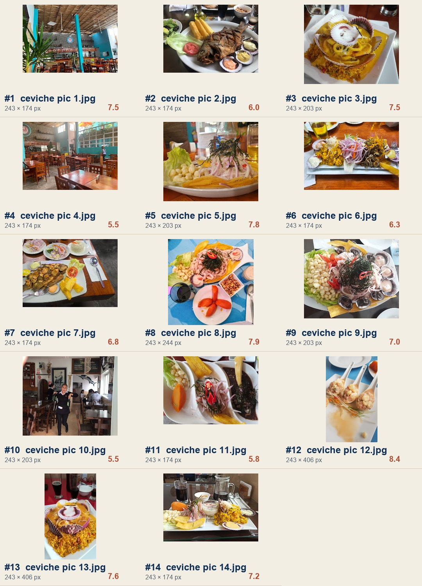

# Asset Audit — Esteros y Manglares (real photos supplied by Andrew)

## Local-file verification — 2026-08-25

The 14 JPEGs are now present in `assets/esteros-photos/` and have been measured from disk. Every image is only 243 px wide; the portrait-oriented #12 and #13 are 243 × 406 px, #8 is 243 × 244 px, and the remaining files are 243 × 174 or 243 × 203 px. The contact sheet below is generated from the local originals, with the prior visual scores retained as a starting point and checked against the rendered crops.

The small source size is a meaningful constraint: use these images in contained cards, framed collage panels, or compact mobile-led sections. Do not stretch them to full-bleed desktop hero backgrounds. Higher-resolution originals should be requested before any public launch.

14 real photographs inspected visually (multimodal review) + 1 Google Business Profile screenshot with review text. These are genuine restaurant/food/interior photos — no stock, no AI generation. Numbered in the order supplied since no filenames exist (pasted inline, not files — see **technical note** at the bottom, this matters for the next step).

## Contact sheet

### HERO CANDIDATES
| # | Depicts | Overall |
|---|---|---|
| 12 | Three ceramic spoons, seafood tartare/causa-style mixture, roe + scallion garnish, clean white surface | **8.4** |
| 8 | Overhead ceviche with scallops fanned around the rim, corn, seaweed garnish, on a blue table | 7.9 |
| 13 | Scallop-shell "arroz con mariscos" with cream/cheese sauce over yellow rice, red tablecloth, beers in frame | 7.6 |

### CEVICHE
| # | Depicts | Overall |
|---|---|---|
| 5 | Ceviche with lettuce, choclo, red onion, seaweed/samphire garnish, fried chip | 7.8 |
| 8 | (see above) | 7.9 |
| 9 | Near-duplicate angle of 8, softer focus | 7.0 |
| 6 | Rectangular "trio" plate — tiradito/ceviche with aji sauce, onion strands, scallop shell | 6.3 |
| 11 | Three-compartment sampler: ceviche portion + fried yuca + dark sauce (parihuela/negro) | 5.8 |

### FRIED FISH / CHICHARRÓN / JALEA
| # | Depicts | Overall |
|---|---|---|
| 7 | Whole fried fish, yuca frita, lime, sauce cups — top-down with cutlery framing | 6.8 |
| 2 | Same dish type, dimmer light, less flattering angle | 6.0 |

### RICE / SEAFOOD DISHES
| # | Depicts | Overall |
|---|---|---|
| 13 | (see hero candidates) | 7.6 |
| 3 | Same dish, individual-size plating, brighter table | 7.5 |

### TABLE SPREADS
| # | Depicts | Overall |
|---|---|---|
| 14 | Full spread — causa, rice, seafood, chicha morada pitcher, glass tabletop | 7.2 |

### RESTAURANT INTERIOR
| # | Depicts | Overall |
|---|---|---|
| 1 | Thatched/bamboo ceiling, **teal-blue pillars**, wood tables, plants in foreground — distinctive, real brand color signal | 7.5 |
| 4 | Wider interior shot, mostly empty, brick + teal wall segment | 5.5 |

### EXTERIOR / LOCATION
**None supplied.** This is a real gap — no storefront/signage photo exists in the set. Flag for the shot list if more photos become available.

### PEOPLE / SERVICE / PREPARATION
| # | Depicts | Overall |
|---|---|---|
| 10 | Server, candid, smiling, black apron, restaurant floor in background | 5.5 (usable for an "about/team" mention only, not a hero) |

## Rejected / not usable as-is
None outright rejected — even the lower scorers (2, 4, 6, 9, 10, 11) are real and usable in a secondary role; none are blurry-to-uselessness, screenshots, watermarked, or off-brand. They're just not hero-tier.

## Scoring detail (1–10)

| # | Appetite | Res.* | Lighting | Authenticity | Composition | Crop flex. | Mobile | Desktop | Brand rel. | **Overall** |
|---|---|---|---|---|---|---|---|---|---|---|
| 1 (interior) | — | 7 | 8 | 10 | 7 | 7 | 7 | 7 | 9 | 7.5 |
| 2 (fried fish A) | 6 | 6 | 5 | 9 | 6 | 6 | 6 | 5 | 6 | 6.0 |
| 3 (rice, individual) | 8 | 7 | 6 | 10 | 7 | 7 | 8 | 6 | 8 | 7.5 |
| 4 (interior wide) | — | 6 | 6 | 10 | 5 | 5 | 5 | 5 | 6 | 5.5 |
| 5 (ceviche, greens) | 8 | 7 | 7 | 10 | 8 | 8 | 8 | 7 | 8 | 7.8 |
| 6 (tiradito trio) | 7 | 6 | 6 | 9 | 7 | 5 | 6 | 6 | 7 | 6.3 |
| 7 (fried fish B) | 7 | 6 | 6 | 9 | 7 | 7 | 7 | 6 | 7 | 6.8 |
| 8 (ceviche, blue table) | 8 | 7 | 7 | 10 | 8 | 7 | 8 | 7 | 9 | 7.9 |
| 9 (ceviche, blue table, dup) | 7 | 6 | 7 | 10 | 6 | 6 | 7 | 6 | 8 | 7.0 |
| 10 (server) | — | 6 | 6 | 10 | 5 | 5 | 5 | 4 | 6 | 5.5 |
| 11 (sampler, dark sauce) | 6 | 6 | 5 | 9 | 6 | 5 | 5 | 5 | 6 | 5.8 |
| **12 (spoons/causa)** | **9** | 7 | 8 | 9 | **9** | 8 | 8 | **9** | 8 | **8.4** |
| 13 (rice, red cloth) | 9 | 7 | 6 | 10 | 7 | 6 | 7 | 8 | 8 | 7.6 |
| 14 (table spread) | 8 | 7 | 7 | 9 | 7 | 5 | 6 | 8 | 8 | 7.2 |

*Resolution: estimated visually, not measured — see technical note.

## Against the hero gate

- **2 photos at 8/10+:** only **1** clears it outright (#12, 8.4). #8 (7.9) and #13 (7.6) are close but I'm not rounding them up.
- **6 photos at 7/10+ (excluding the hero):** met — #3, #5, #8, #9, #13, #14 all clear 7.0.

Honest read: this is a real, workable asset set — #12 is a genuinely strong, distinctive hero, and there's a solid supporting bench — but it's not a full pass of the strict "two 8+" bar. I'm not stopping the whole effort over that half-point gap (that would be pedantic given you've now supplied real photos and asked for concepts today), but I'm not rounding the numbers to pretend otherwise either.

## Business data update (from your Google Maps screenshot)

New confirmed facts, folding into what's already known:
- **Dine-in · Drive-through · No-contact delivery** are listed as Google-confirmed service options (drive-through is unusual for this format — worth verifying it means curbside pickup, not a literal drive-through lane, before using it in copy).
- Hours snapshot: "Closed · Opens 11:30 AM Wed" — consistent with the earlier-found Restaurant Guru table (Wed–Mon service), still not independently confirmed for every day.
- Address per Google: **C. Salaverry 1098, Surquillo 15098** — same number Restaurant Guru had, still conflicts with Facebook's "1082." Per your instruction, **not** using either number in customer-facing copy.
- Review text confirms real dish names beyond the original six: **"seafood volcano rice"** (Arroz Volcán de Mariscos), **"grilled octopus risotto"** (Risotto con Pulpo a la Parrilla) — both now independently corroborated by a real customer, not just a menu-adjacent guess.
- Also mentioned by reviewers: leche de tigre, fish chowder ("parihuela"?), black clam ceviche, whole sea bass, causa — none of these are confidently matched to a specific supplied photo, so none get labeled by dish name per your "don't guess" rule.
- Reviews are mixed, not uniformly glowing — several recent ones cite slow service, high prices for portion size, and card-payment friction (cash/Yape/Plin only, no cards, undisclosed until the bill arrives). Worth knowing for the sales conversation even though it won't appear in site copy.

## Technical note — prior inspection limitation resolved

The earlier version of this audit was based on pasted images and could not render real pixels. That limitation is resolved: the originals are now copied into `assets/esteros-photos/`, the contact sheet is generated from those files, and the three concepts reference the real images directly.

## Follow-up shot list

Before public launch, replace the low-resolution originals with higher-resolution exports and add one exterior/signage image plus one sharper interior image. Keep the current local set for concept review because it accurately represents the restaurant's available visual material.
